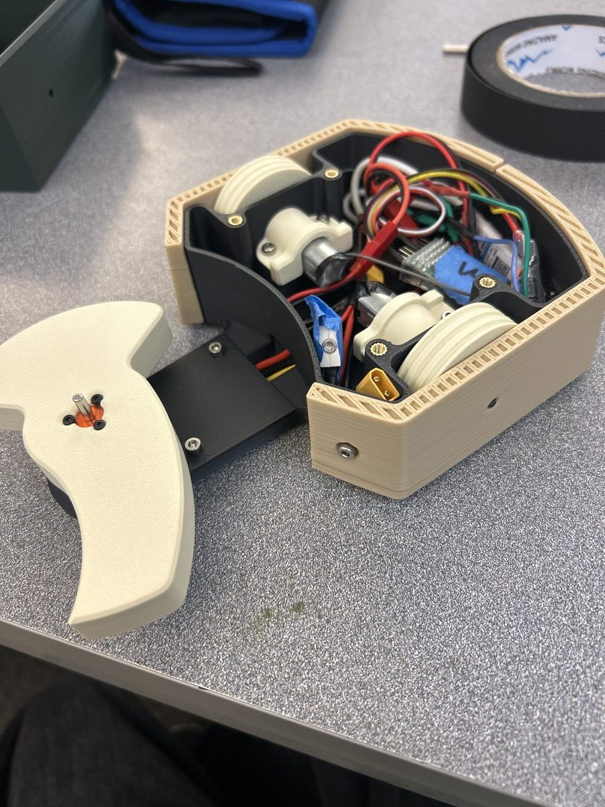
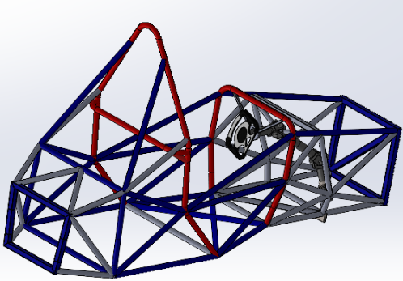
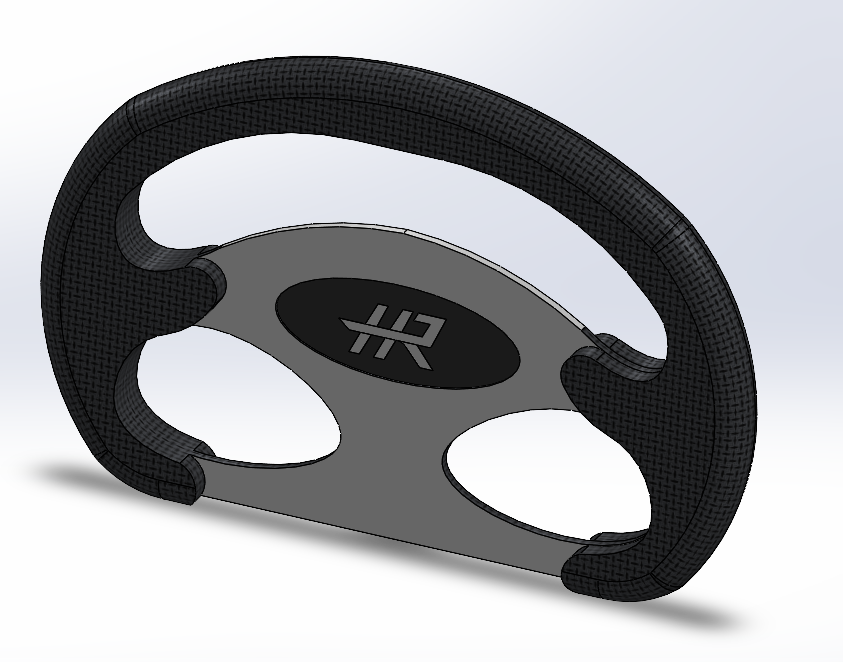
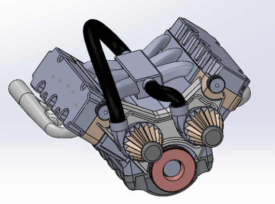

## Featured Engineering Projects

[Resume (PDF)]({{ "/resume.pdf" | relative_url }})

  <!-- Project 1: Antweight Combat Robot -->
  

    <h3>Antweight Combat Robot</h3>
    
<em>UC Riverside — Highlander Combat Robotics (2026)</em>

    

      
    

    
<em>Click thumbnail to expand</em>

    <ul>
      <li>Designed and built a 1-pound 3D-printed combat robot, modeling the chassis and components in Onshape.</li>
      <li>Wired and soldered the full electronics package: LiPo batteries, brushless motors, ESCs, and RC receiver.</li>
      <li>Integrated the weapon system with the drive electronics.</li>
      <li>The photo shows the build up close: 3D-printed chassis with brass heat-set inserts, drive motors, and the wiring harness packed into the 1-lb antweight limit.</li>
    </ul>
  

  

  <!-- Project 2: Formula SAE Steering System -->
  

    <h3>Formula SAE Steering System</h3>
    
<em>UC Riverside — Highlander Racing (2025)</em>

    

      
      
    

    
<em>Click thumbnails to expand</em>

    <ul>
      <li>Modeled the Formula SAE steering system in SolidWorks.</li>
      <li>Member of Highlander Racing, UC Riverside's Formula SAE team, since January 2025.</li>
      <li>The steering system was modeled in SolidWorks as part of the full chassis assembly, with the wheel carrying the Highlander Racing mark.</li>
    </ul>
  

  

  <!-- Project 3: SolidWorks V6 Engine -->
  

    <h3>SolidWorks V6 Engine Assembly</h3>
    
<em>UC Riverside — Formula Society of Automotive Engineers (2026)</em>

    

      
    

    
<em>Click thumbnail to expand</em>

    <ul>
      <li>Modeled a fully assembled V6 engine in SolidWorks utilizing 30+ individual parts and complex subassemblies.</li>
      <li>Applied Design for Manufacturing (DFM) concepts and mechanical design principles under technical instruction.</li>
      <li>The render shows the full assembly, from the intake runners up top to the front pulley drive, with each system modeled as its own subassembly.</li>
    </ul>
  

  

  <!-- Project 4: Java Discord Bot -->
  

    <h3>Java Discord Bot</h3>
    
<em>Personal Project</em>

    <ul>
      <li>Utilized core Java programming principles to build a responsive automated chat tool.</li>
      <li>Accessed external API information to dynamically deliver time/date data and fun facts about pet breeds.</li>
      <li>Undertook several hours of rigorous testing, debugging, and continuous updating.</li>
      <li>Built around event-driven programming in Java — the bot listens for commands and replies with live data from external APIs.</li>
    </ul>
  

<!-- Simple Lightbox Modal Container for Image Zooming/Carousel Effect -->

  &times;
  

